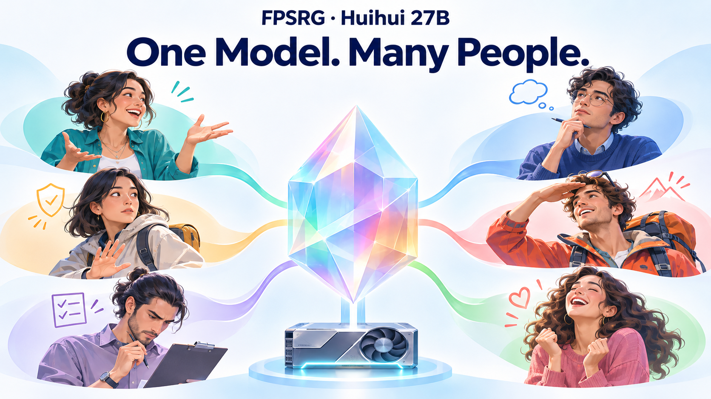

# FPSRG

[中文](README.zh-CN.md)



**Build diverse participants. Serve them together.**

Build heterogeneous model profiles, measure their joint responses, and serve them on a shared model with per-request steering.

Create consumers, training partners and interactive characters with different priorities. Mix different personalities, prompts and histories in the same GPU batch. Explore the [Huihui model page](model_cards/huihui-27b/README.md) for original dialogue examples, emotion controls and application workflows.

## Contents

| Directory | Contents |
|---|---|
| [research](research/README.md) | Vector discovery, refinement, scoring and grid analysis |
| [modules/vector_vllm](modules/vector_vllm/README.md) | Standalone vLLM steering package; mixed profiles and prompts in one batch |
| [artifacts](artifacts/README.md) | Released vectors, measured catalogs and quality filters |
| [demo](demo/README.md) | PersonLab web interface with personality, joy and anger controls |
| [models](models/README.md) | Weight manifests and storage layout |
| [model_cards](model_cards/README.md) | Bilingual model pages, illustrations and original response examples |
| [scripts](scripts/README.md) | Asset validation and local weight installation |

## Profiles

| Artifact | Model | Dimensions | Grid / serving candidates | Scoring |
|---|---|---|---:|---|
| `qwen35-ten-off` | Qwen3.5-27B + first-person LoRA | O C E A N R T V M S | 59,049 / 33,942 | Non-thinking, first-token probabilities |
| `huihui-six-thinking` | Huihui 27B, full1500 epoch 2 | A C N R M T | 729 / 657 | Thinking, complete generated answers |

The six-dimensional artifact also includes the demo's 2× joy and anger vectors. Its catalog contains the measured personality scores before emotion is applied.

## Start

```bash
git clone https://github.com/yoolee-ai/FPSRG.git
cd FPSRG
export FPSRG_HOME="$PWD"
bash modules/vector_vllm/install_runtime.sh
# Use the module runtime for subsequent Python commands.
source modules/vector_vllm/.runtime/venv/bin/activate
python scripts/verify_assets.py
```

Install the matching weights using [models/README.md](models/README.md), then use the runtime's [single-GPU startup and API examples](modules/vector_vllm/README.md). The [demo guide](demo/README.md) starts the browser interface against that API.

Each request carries its own profile and messages. Concurrent requests may share the model while retaining separate steering and cache identities. The current backend uses a single-GPU replica, eager execution, continuous batching and chunked prefill.

## Layout

```text
FPSRG/
  artifacts/{qwen35-ten-off,huihui-six-thinking}/
  models/{qwen35-base,persononly-lora,huihui-six}/  # installed separately
  model_cards/huihui-27b/
  modules/vector_vllm/
  research/
  demo/
  scripts/
```

Set `FPSRG_HOME` to this checkout. Model directories can be mounted from an internal model store. Credentials are environment variables; runtime outputs stay outside Git.

## Paper

**FPSRG: Heterogeneous User Simulation — First-Person Post-Training and Multidimensional Semantic Response Grids**  
Ruimin Pei, Haibo Liu, Fan Zhang, Xunhua Guo.

This repository is the private company delivery of the implementation and selected artifacts. See [THIRD_PARTY_NOTICES.md](THIRD_PARTY_NOTICES.md) for upstream components.
