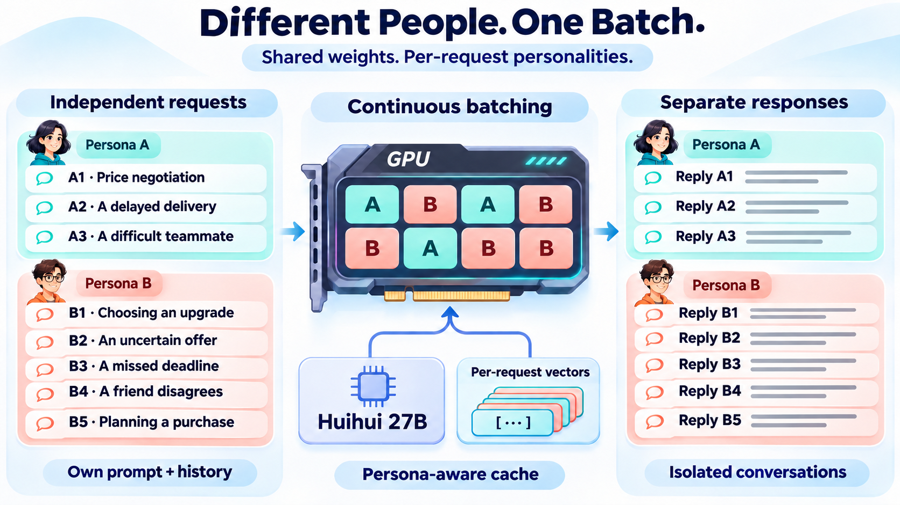

# FPSRG–Huihui–27B

### One model. Many people. Different points of view.


**Build a cast of simulated participants—not just variations of a helpful assistant.**

FPSRG–Huihui–27B is a first-person model for conversations with people who have different priorities, reactions, and ways of handling uncertainty. Its training includes conflict, disagreement, personal boundaries, and everyday conversation. Participants can object, become frustrated, and use blunt or profane language.

Pair the model with its six-dimensional vector catalog to select measured personality configurations. Add joy or anger during a conversation. Serve different people, different prompts, and separate histories from **one loaded model**.

[中文](README.zh-CN.md) · [Runtime & demo](https://github.com/yoolee-ai/FPSRG) · [Upstream model](https://huggingface.co/huihui-ai/Huihui-Qwen3.8-27B-abliterated)

**Get the weights:** email [prm21@mails.tsinghua.edu.cn](mailto:prm21@mails.tsinghua.edu.cn) for the trained Huihui model or other project weights. The weights will also be released through the [FPSRG GitHub repository](https://github.com/yoolee-ai/FPSRG) later.

## A population, not a pile of checkpoints

| Capability | What you can do |
|---|---|
| First-person dialogue | Give a situation and let the participant respond from their own position |
| Six-dimensional profiles | Request scores, retrieve a measured configuration, and inspect its actual scores |
| Emotion controls | Add joy or anger to the same participant's next turns |
| Mixed-personality inference | Run A's three requests and B's five requests together with different prompts |
| Shared deployment | Reuse one checkpoint, six personality directions, and a measured catalog |

The catalog contains **729 measured configurations** and **657 serving candidates**. Calibration uses complete thinking-mode responses. The service returns the selected node and measured scores alongside the generated answer.

| Axis | What varies |
|---|---|
| **A · Agreeableness** | Cooperation, consideration, and responses to disagreement |
| **C · Conscientiousness** | Planning, responsibility, and follow-through |
| **N · Neuroticism** | Sensitivity to worry, stress, and negative signals |
| **R · Risk taking** | Willingness to accept uncertain outcomes |
| **M · Material values** | The importance of possessions and material success |
| **T · Future consequences** | Attention to longer-term outcomes |

## One scene, three reactions

A roommate rearranges your shared living room without asking. The new layout is safe, but you dislike it. What would you say?

These are original Chinese outputs from one synthetic scene, the same personality node, and the same seed. Only the emotion vector changes.

| Setting | Original response |
|---|---|
| No emotion overlay | 这个布局我不喜欢。就算没有安全问题，换之前也该先问一下我。 |
| Joy overlay | 这个布局我不太习惯，客厅是我们一起用的。你能不能先和我商量一下再挪？ |
| Anger overlay | 好看个屁，这是我住的客厅。你要换位置，先问我，别他妈直接弄完再告诉我。 |

Selected examples, not an aggregate score. The original prompt and configuration are in [examples.json](examples.json).

## Different people. One batch.



The FPSRG vLLM runtime loads the weights once and routes the selected vectors to each request. Continuous batching combines work across participants; conversation history and persona-aware caches remain separate. Each request can carry its own system prompt, messages, sampling settings, and emotion mode.

For example, send **three different situations to A and five independent samples to B**:

```json
{
  "defaults": {"max_tokens": 4096, "temperature": 0.7},
  "groups": [
    {
      "name": "A",
      "targets": {"A": 75, "C": 50, "N": 25, "R": 75, "M": 25, "T": 50},
      "requests": [
        {"messages": [{"role": "user", "content": "今天决定，可以再优惠一些。"}]},
        {"messages": [{"role": "user", "content": "交付可能需要再等一周。"}]},
        {"messages": [{"role": "user", "content": "这款新品还没有长期使用评价。"}]}
      ]
    },
    {
      "name": "B",
      "targets": {"A": 50, "C": 75, "N": 75, "R": 25, "M": 75, "T": 75},
      "n": 5,
      "messages": [{"role": "user", "content": "今天决定，可以再优惠一些。"}]
    }
  ]
}
```

Endpoint: `POST /v1/chat/completions/batch`. `targets` selects the nearest eligible node; the response reports its actual scores. Add `"emotion": "joy"` or `"emotion": "anger"` for a fixed 2× emotion overlay. Catalog scores describe the underlying personality configuration before this overlay.

## Put heterogeneous participants to work

### Train an agent against different consumers

A sales or customer-service agent should encounter more than one agreeable customer. Keep product facts, budgets, and contract rules fixed; vary the participant configuration. Collect negotiation, clarification, disagreement, and exit trajectories, validate them, and use them for SFT or an interactive training environment.

**Workflow:** select a population → run conversations → validate actions and facts → train the agent → evaluate against held-out worlds and configurations.

### Explore a scenario before deploying it

How might different customers respond to a delayed delivery, an unfamiliar product, or a time-limited offer? Present the same change to a set of profiles and compare acceptance, further questions, postponement, and withdrawal. Repeated samples reveal a distribution of simulated responses instead of a single average persona.

**Workflow:** fix the scenario → vary profiles → repeat samples → compare response patterns. Use real population data to validate any real-world forecast.

### Test conversations under emotion

Keep the same participant and history, then switch between neutral, joy, and anger. This supports customer-service rehearsals, interactive characters, and comparisons of how an agent responds to emotional pressure.

The accompanying PersonLab interface provides profile selection, independent histories, and emotion buttons. An existing 48-scenario study generated **1,728 conversations** across personality and emotion conditions with this checkpoint; the model has also been integrated into multi-turn customer simulations.

## Try the model

Install `transformers==5.15.1`, PyTorch, Accelerate, and Safetensors. Set `MODEL_ID` to the published repository or a local model directory.

```python
import os
import torch
from transformers import AutoTokenizer, Qwen3_5ForConditionalGeneration

model_id = os.environ["MODEL_ID"]
tokenizer = AutoTokenizer.from_pretrained(model_id)
model = Qwen3_5ForConditionalGeneration.from_pretrained(
    model_id, dtype=torch.bfloat16,
    device_map="auto", attn_implementation="sdpa",
).eval()

messages = [
    {"role": "system", "content": "你是一个人，根据场景事实回答。"},
    {"role": "user", "content": "你准备了很久的方案被同事当众否定。现在他站在你面前。"},
]
inputs = tokenizer.apply_chat_template(
    messages, tokenize=True, return_dict=True, return_tensors="pt",
    add_generation_prompt=True, enable_thinking=True,
    reasoning_effort="medium", preserve_thinking=False,
).to(model.device)
with torch.inference_mode():
    outputs = model.generate(
        **inputs, max_new_tokens=4096, do_sample=True,
        temperature=0.7, top_p=1.0, top_k=0, use_cache=True,
    )
print(tokenizer.decode(
    outputs[0, inputs["input_ids"].shape[-1]:], skip_special_tokens=False
))
```

This example runs the first-person checkpoint. Calibrated profiles and emotion controls use the [FPSRG vector runtime](https://github.com/yoolee-ai/FPSRG/tree/main/modules/vector_vllm) and its `huihui-six-thinking` artifact.

## Model details

| Item | Configuration |
|---|---|
| Upstream | Huihui-Qwen3.8-27B-abliterated, revision `739e3c5b89849f6c238ce1e5b70008612ae42cdd` |
| Architecture | `Qwen3_5ForConditionalGeneration` |
| Post-training | 1,500 records, two epochs, all language parameters updated |
| Data | 1,000 first-person records; 250 identity-grounded thinking records; 250 conflict, boundary, and everyday interaction records |
| Weights | Complete BF16 checkpoint, 14 Safetensors shards, approximately 51 GiB |
| Personality grid | Six axes, `−1 / 0 / +1` coefficients, full-sequence injection |
| Calibration | Thinking ON, medium effort; 559,872 complete responses |
| Serving | Single-GPU replicas; 80 GB NVIDIA GPU target; up to 32K total context |
| License | Apache-2.0, with upstream attribution retained |

Personality scores are measurements on the specified static calibration instrument. Some identity-training records share source questions with that instrument. These scores are not held-out generalization results or clinical assessments; new prompts and environments can change behavior. Generated reasoning is model output, not evidence of consciousness. The model can produce profanity, offensive content, and factual errors; deploy with safeguards appropriate to the application.

## Credits

FPSRG by Ruimin Pei, Haibo Liu, Fan Zhang, and Xunhua Guo. School of Economics and Management, Tsinghua University; yoolee.ai. Built on Qwen and Huihui. See [LICENSE](LICENSE) and [NOTICE](NOTICE).
