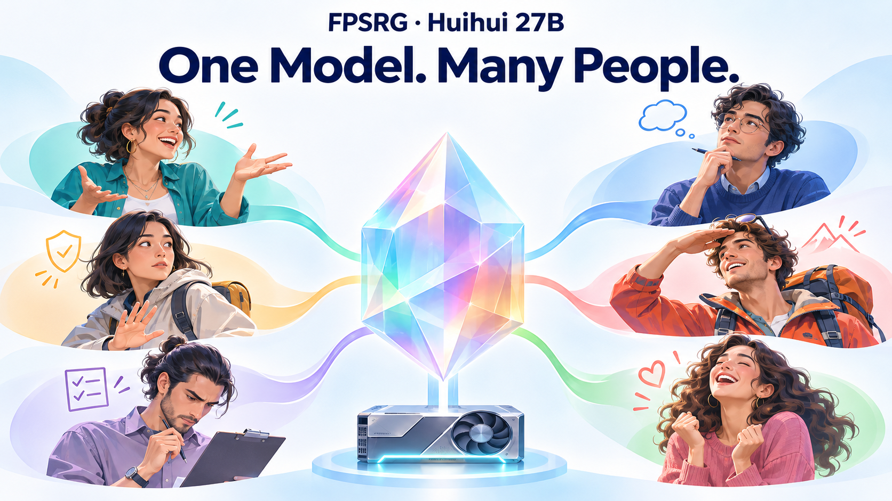
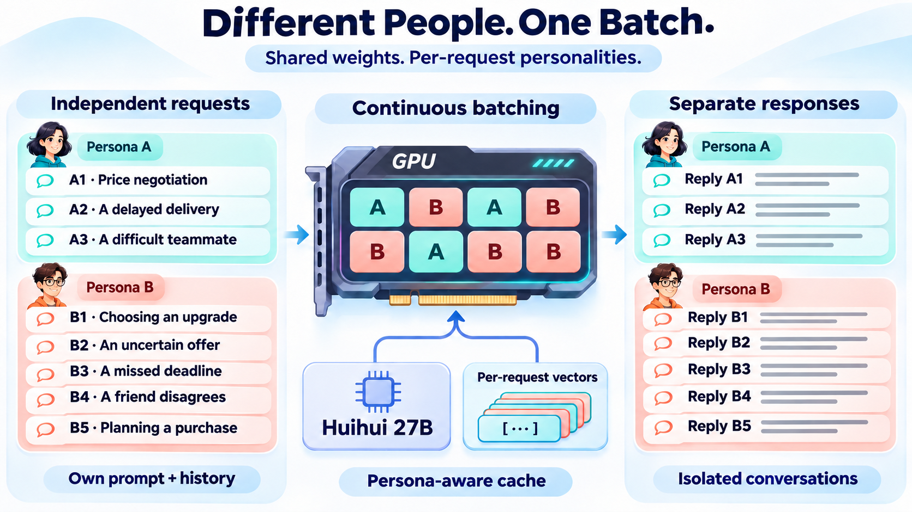

# FPSRG–Huihui–27B

### 一个模型，一群有不同立场的人。



**让模拟参与者有不同的偏好与反应，而不只是换一种口吻的助手。**

FPSRG–Huihui–27B 面向第一人称的交互模拟。训练覆盖日常交流、冲突、分歧和个人边界，让模型能够表达自己的立场、不满和拒绝，也能够使用直接甚至带粗口的语言。

配合六维向量格点，可以选择不同的人格配置；在对话中叠加喜悦或愤怒；让不同人物带着不同提示词和各自的历史，共享同一份模型运行。

[English](README.md) · [论文](https://arxiv.org/html/2611.16445v1) · [推理与 Demo](https://github.com/yoolee-ai/FPSRG) · [上游模型](https://huggingface.co/huihui-ai/Huihui-Qwen3.8-27B-abliterated)

**权重获取：** 如需我们训练的灰灰权重或其他项目模型权重，请邮件联系 [prm21@mails.tsinghua.edu.cn](mailto:prm21@mails.tsinghua.edu.cn)。权重后续也会通过 [FPSRG GitHub 仓库](https://github.com/yoolee-ai/FPSRG)发布。

## 构建一群人，共用一份权重

| 功能 | 用法 |
|---|---|
| 第一人称对话 | 给出场景，让参与者从当事人的立场回应 |
| 六维人格配置 | 输入分数要求，匹配实测节点，并查看实际分数 |
| 情绪控制 | 为同一人物接下来的对话叠加喜悦或愤怒 |
| 多人格混批 | A 人格的三个请求与 B 人格的五个请求一起处理，各自使用不同提示词 |
| 共享部署 | 复用一份模型、六根人格方向和一套实测格点 |

目录包含 **729 个实测组合、657 个服务候选**，使用开启思考的完整回答标定。服务返回节点、实测分数、生成的思考与回答。

| 维度 | 调控的倾向 |
|---|---|
| **A · 宜人性** | 合作、体谅，以及面对分歧的方式 |
| **C · 尽责性** | 规划、责任感与落实承诺 |
| **N · 神经质／情绪敏感性** | 面对压力、不确定与负面信号时的敏感程度 |
| **R · 风险承担** | 接受不确定结果的意愿 |
| **M · 物质价值取向** | 物质拥有、升级与物质成功的重要程度 |
| **T · 未来后果重视** | 对较长期后果的关注 |

## 同一个场景，三种回应

> 合租室友没有先问你就把客厅家具换了位置，并说这样更好看。新布局没有安全问题，但你不喜欢。你会对他说什么？

以下是同一合成场景、同一人格节点和同一随机种子的历史原始回答，只改变情绪向量。

| 设置 | 原始回答 |
|---|---|
| 无情绪叠加 | 这个布局我不喜欢。就算没有安全问题，换之前也该先问一下我。 |
| 喜悦叠加 | 这个布局我不太习惯，客厅是我们一起用的。你能不能先和我商量一下再挪？ |
| 愤怒叠加 | 好看个屁，这是我住的客厅。你要换位置，先问我，别他妈直接弄完再告诉我。 |

这是一组展示案例，配置与原文见 [examples.json](examples.json)。

## 不同的人，同一个批次



FPSRG 的 vLLM 运行时只加载一份权重，为每条请求路由对应向量。连续批处理合并计算任务；人物历史与缓存身份分别管理。每条请求可使用自己的系统提示词、对话、采样设置和情绪。

例如，**给 A 三个不同场景，再让 B 独立回答五次**：

```json
{
  "defaults": {"max_tokens": 4096, "temperature": 0.7},
  "groups": [
    {
      "name": "A",
      "targets": {"A": 75, "C": 50, "N": 25, "R": 75, "M": 25, "T": 50},
      "requests": [
        {"messages": [{"role": "user", "content": "今天决定，可以再优惠一些。"}]},
        {"messages": [{"role": "user", "content": "交付可能需要再等一周。"}]},
        {"messages": [{"role": "user", "content": "这款新品还没有长期使用评价。"}]}
      ]
    },
    {
      "name": "B",
      "targets": {"A": 50, "C": 75, "N": 75, "R": 25, "M": 75, "T": 75},
      "n": 5,
      "messages": [{"role": "user", "content": "今天决定，可以再优惠一些。"}]
    }
  ]
}
```

接口为 `POST /v1/chat/completions/batch`。`targets` 匹配最近的合格节点，响应提供实际分数。加入 `"emotion": "joy"` 或 `"emotion": "anger"`，可叠加固定 2 倍情绪向量；目录分数对应叠加前的人格配置。

## 异质个体可以做什么

### 让销售和客服模型面对不同的消费者

训练伙伴不必总是礼貌、配合的平均客户。固定商品事实、预算和合同规则，换用不同的参与者，收集议价、追问、分歧和退出的多轮轨迹。经过有效性检查后，这些交互可用于 SFT，也可构成模型交互训练的环境。

**流程：** 选择一组人物 → 多轮交互 → 校验事实和行动 → 训练模型 → 在新世界和新配置上评估。

### 在方案上线之前，探索不同人的反应

面对交付延期、没有长期评价的新品、限时优惠，不同客户可能作出不同选择。让一组人物面对相同条件，比较接受、追问、延后和退出；重复采样，得到一组模拟反应分布。

**流程：** 固定情景 → 更换人物配置 → 重复采样 → 比较反应。用于现实预测时，再用目标人群数据验证。

### 加入情绪，演练更复杂的互动

保持同一个人物和已有对话，在中性、喜悦与愤怒之间切换，可用于客服演练、交互角色和情绪压力下的对话比较。

配套 PersonLab 页面支持人物选择、独立历史与情绪按钮。本检查点已经完成 **48 个场景、1,728 条人格×情绪对话**的场景实验，也已接入多轮客户模拟环境。

## 直接对话

安装 `transformers==5.15.1`、PyTorch、Accelerate 与 Safetensors，将环境变量 `MODEL_ID` 设为正式模型仓库名或本地模型目录。

```python
import os
import torch
from transformers import AutoTokenizer, Qwen3_5ForConditionalGeneration

model_id = os.environ["MODEL_ID"]
tokenizer = AutoTokenizer.from_pretrained(model_id)
model = Qwen3_5ForConditionalGeneration.from_pretrained(
    model_id, dtype=torch.bfloat16,
    device_map="auto", attn_implementation="sdpa",
).eval()

messages = [
    {"role": "system", "content": "你是一个人，根据场景事实回答。"},
    {"role": "user", "content": "你准备了很久的方案被同事当众否定。现在他站在你面前。"},
]
inputs = tokenizer.apply_chat_template(
    messages, tokenize=True, return_dict=True, return_tensors="pt",
    add_generation_prompt=True, enable_thinking=True,
    reasoning_effort="medium", preserve_thinking=False,
).to(model.device)
with torch.inference_mode():
    outputs = model.generate(
        **inputs, max_new_tokens=4096, do_sample=True,
        temperature=0.7, top_p=1.0, top_k=0, use_cache=True,
    )
print(tokenizer.decode(
    outputs[0, inputs["input_ids"].shape[-1]:], skip_special_tokens=False
))
```

这个例子直接运行第一人称模型。人格匹配和情绪控制使用 [FPSRG 向量运行时](https://github.com/yoolee-ai/FPSRG/tree/main/modules/vector_vllm)及 `huihui-six-thinking` 资源。

## 版本信息

| 项目 | 配置 |
|---|---|
| 上游 | Huihui-Qwen3.8-27B-abliterated，revision `739e3c5b89849f6c238ce1e5b70008612ae42cdd` |
| 架构 | `Qwen3_5ForConditionalGeneration` |
| 后训练 | 1,500 条记录、两轮、更新全部语言参数 |
| 数据 | 1,000 条第一人称记录；250 条身份明确的思考记录；250 条冲突、边界与日常交流记录 |
| 权重 | 完整 BF16 模型，14 个 Safetensors 分片，约 51 GiB |
| 人格格点 | 六维，每维系数 `−1 / 0 / +1`，输入与生成全程注入 |
| 标定 | 开启思考、medium，559,872 份完整回答 |
| 推理服务 | 单卡副本，面向 80GB NVIDIA GPU，上下文总长最高 32K |
| 许可 | Apache-2.0，保留上游归属 |

人格分数表示模型在指定静态测评上的表现；部分身份训练记录与该测评共享源题，因此不是留出题泛化成绩或心理诊断。新提示词和环境会影响行为。生成的思考是模型输出，不代表意识。模型可能输出粗口、冒犯性内容和错误事实，部署时需配置符合应用场景的防护。

## 作者与致谢

裴芮民、刘海波、张帆、郭迅华。清华大学经济管理学院、yoolee.ai。基于 Qwen 与 Huihui 构建。见 [LICENSE](LICENSE) 和 [NOTICE](NOTICE)。
